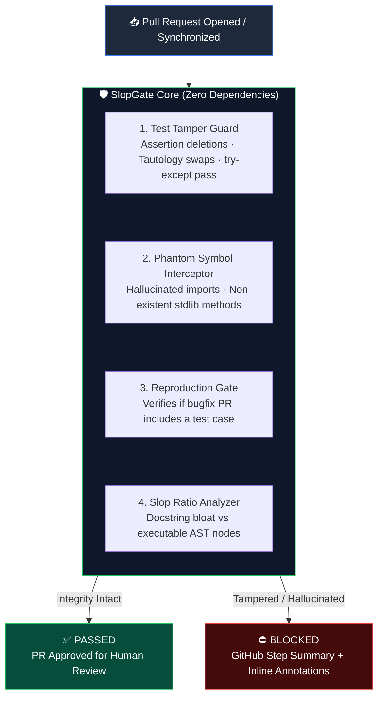

<div align="center">

# 🛡️ SlopGate
### *The AST-Based Code Integrity & PR Shield for Open Source Maintainers*

**Stop AI slop pull requests before they burn out your maintainers.**  
*Zero-dependency AST analysis that intercepts test tampering, neutered assertions, and hallucinated packages in < 0.05 seconds.*

<br/>

[](https://github.com/Shinraya-Tech-Labs/slopgate/actions/workflows/ci.yml)
[](https://python.org)
[](pyproject.toml)
[](LICENSE)
[](action.yml)
[](https://github.com/Shinraya-Tech-Labs/slopgate)

<br/>

```bash
# 🎮 Try the instant interactive simulator in your terminal
pip install slopgate
slopgate demo
```

*Runs locally. Zero API keys required. No LLM tokens billed.*

<br/>

[**Why SlopGate**](#-the-problem-death-by-a-thousand-slops) · [**How It Works**](#-how-it-works) · [**10-Second Setup**](#-10-second-github-action-setup) · [**The 4 Invariant Shields**](#-the-4-invariant-shields) · [**Comparison**](#-slopgate-vs-text-detectors) · [**Badge**](#-add-the-badge-to-your-readme)

</div>

---

## 💥 The Problem: "Death by a Thousand Slops"

> *"The telltale signs are always the same: reports that arrive as walls of perfectly formatted text, complete with extensive bullet point lists and flawless English... and debugging information for functions that do not exist. This low-effort, high-impact abuse pattern is a denial-of-service attack on open source."*  
> — **Daniel Stenberg**, Founder & Maintainer of `curl`

According to recent open-source ecosystem studies, **maintainers now spend over 60% of their engineering capacity on maintenance and triage**. 

With the explosive rise of AI coding agents, thousands of automated and hallucinated pull requests are submitted daily. These PRs look clean on the surface:
1. **They pass CI by weakening tests**: Deleting `assert` statements or changing `assert result == expected` to `assert result is not None` or `assert True`.
2. **They hallucinate libraries**: Importing non-existent cloud packages or inventing fake methods on standard library objects (`json.loads_async`, `os.mkdir_p`).
3. **They bury trivial logic in 50 lines of AI docstring buzzwords**: Masking unverified code diffs behind walls of AI-generated markdown.

Existing "AI detector" tools try to detect "AI-sounding English text." **That is the wrong layer to inspect.** It creates false positives on non-native English speakers while letting broken code slip right through.

**SlopGate does not judge your English. SlopGate enforces Code & Test Invariants.**

---

## ⚡ How It Works

SlopGate parses the unified git diff directly into an **AST (Abstract Syntax Tree)** in < 50 milliseconds:



---

## 🖥️ Live Terminal Simulation

Run `slopgate demo` to see SlopGate catch 3 real-world scenarios in real-time:

```text
=======================================================
 🎮 SLOPGATE INTERACTIVE AUDIT SIMULATOR v0.1.0
=======================================================

Scenario 1: Rogue AI PR weakens test assertion to pass CI
Simulating: Contributor PR replaces 'assert val == False' with 'assert val is not None'...
=======================================================
 🛡️  SLOPGATE — Code & PR Integrity Shield 
=======================================================
 Diff: 2 files | +2 / -1 | Code: +0 | Tests: +1 | Docs: +1
 Status: [WARNING] ⚠️ SlopGate Warning: Found 1 non-blocking notice(s).

Violations Detected:
  • [SG-ASSERT_WEAKENED] Assert Weakened
    Location: tests/test_auth.py:14
    Details:  Weakened assertion: 'is not None' checks existence instead of value equivalence.
    Snippet:  assert verify_token("expired_xyz") is not None

-------------------------------------------------------
Scenario 2: AI PR with phantom packages and hallucinated stdlib APIs
Simulating: PR imports 'phantom_ai_driver' and calls 'json.loads_async()'...
=======================================================
 🛡️  SLOPGATE — Code & PR Integrity Shield 
=======================================================
 Diff: 1 files | +3 / -1 | Code: +3 | Tests: +0 | Docs: +0
 Status: [BLOCKED] ⛔ SlopGate Blocked: Found 2 critical integrity violation(s).

Violations Detected:
  • [SG-HALLUCINATED_IMPORT] Hallucinated Import
    Location: src/database.py:5
    Details:  Package 'phantom_ai_driver' is not in stdlib, project dependencies, or local modules.
    Snippet:  symbol: phantom_ai_driver

  • [SG-HALLUCINATED_STDLIB_METHOD] Hallucinated Stdlib Method
    Location: src/database.py:9
    Details:  json has no async loads method.
    Snippet:  symbol: json.loads_async
```

---

## 🚀 10-Second GitHub Action Setup

Add `.github/workflows/slopgate.yml` to your repository:

```yaml
name: SlopGate PR Integrity Check

on:
  pull_request:
    types: [opened, synchronize, reopened]

permissions:
  contents: read
  pull-requests: write

jobs:
  slopgate:
    name: SlopGate PR Audit
    runs-on: ubuntu-latest
    steps:
      - uses: actions/checkout@v4
        with:
          fetch-depth: 0

      - name: Run SlopGate Shield
        uses: Shinraya-Tech-Labs/slopgate@main
        with:
          fail-on: blocked   # 'blocked' (fails on tamper/hallucinations) or 'warning'
```

*Or install it automatically into your repo:*
```bash
slopgate install
```

---

## 🛡️ The 4 Invariant Shields

### 1. Test Tampering & Neutering Guard
Detects when a pull request attempts to pass failing CI by:
- Deleting `assert` statements in existing test files.
- Replacing strict comparisons (`assert x == 42`) with tautologies (`assert x is not None` or `assert True` or `assert len(x) >= 0`).
- Wrapping failing assertions in silent `try: ... except: pass` blocks.
- Explicitly adding `@pytest.mark.skip` to failing tests.

### 2. Phantom Symbol & Hallucinated Import Detector
- Intercepts newly added `import <package>` that does not exist in standard library, project manifests (`pyproject.toml`, `requirements.txt`), or local modules.
- Intercepts made-up standard library methods (e.g. `json.loads_async`, `os.mkdir_p`, `re.match_all`).

### 3. Reproduction Gate
- Checks if a pull request modifies core production logic without adding or updating a test.
- Reminds the author: *"Please supply a reproduction test verifying the bug before this patch."*

### 4. Slop-to-Logic Ratio
- Computes $\frac{\text{Docstring and explanatory comments added}}{\text{Executable AST nodes added}}$.
- Flags PRs that paste 60 lines of AI-generated architectural buzzwords for a 1-line non-functional change.

---

## 📊 SlopGate vs Text Detectors

| Capability | SlopGate | Text-Based "AI Detectors" | Standard CI Linter (flake8 / ruff) |
|---|:---:|:---:|:---:|
| **Underlying Analysis** | **AST Invariants** | Probabilistic Text Heuristics | Static Style Rules |
| **Detects Weakened Assertions** | ✅ **Yes** | ❌ No | ❌ No |
| **Detects Hallucinated Packages** | ✅ **Yes** | ❌ No | ⚠️ Only if installed |
| **Runtime Speed** | **< 0.05s** | 2.0s – 8.0s (LLM calls) | ~ 0.5s |
| **API Costs / Token Spend** | **$0.00 (Zero)** | $0.05 – $0.20 per PR | $0.00 |
| **False Positives on Non-Native English** | **Zero (Code only)** | ⚠️ High (Bans legitimate devs) | Zero |
| **External Dependencies** | **0 (Stdlib only)** | Heavy / Cloud API | Python virtualenv |

---

## 🏷️ Add the Badge to Your README

Show your contributors that your project values code integrity:

```markdown
[](https://github.com/Shinraya-Tech-Labs/slopgate)
```

Preview:
[](https://github.com/Shinraya-Tech-Labs/slopgate)

---

## 🗺️ Roadmap

- [x] Python AST assertion tamper detection
- [x] Python stdlib & dependency hallucination detector
- [x] Composite GitHub Action with Step Summary output
- [x] Interactive Terminal Simulator (`slopgate demo`)
- [ ] TypeScript / JavaScript AST Invariant Engine (Babel / SWC parser)
- [ ] Go AST Invariant Engine
- [ ] Automatic PR reply bot with reproduction sandbox runner

---

## 🤝 Contributing

We welcome contributions! Please see [CONTRIBUTING.md](CONTRIBUTING.md) for local development and testing guidelines.

To run tests locally:
```bash
git clone https://github.com/Shinraya-Tech-Labs/slopgate.git
cd slopgate
python tests/test_tamper.py
python tests/test_phantom.py
python tests/test_engine.py
```

---

## 📄 License

**Apache 2.0** — Created by [Shinraya Tech Labs](https://github.com/Shinraya-Tech-Labs) and open-source contributors.
